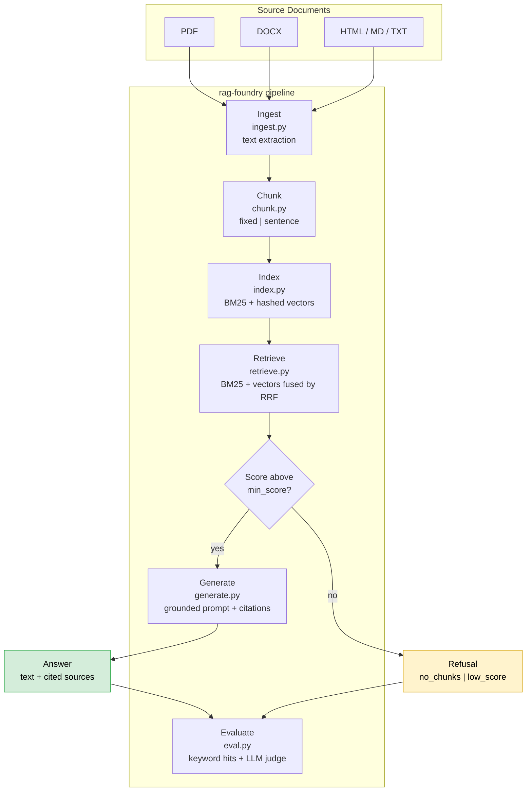

# rag-foundry

**A retrieval-augmented generation pipeline you can read end to end — document ingestion, hybrid retrieval, grounded generation, and an evaluation harness, with zero third-party runtime dependencies.**

[](https://www.python.org/)
[](LICENSE)
[](pyproject.toml)
[](https://docs.python.org/3/library/)

---

## Why this exists

Most RAG tutorials stop at "call an embedding API and do a similarity search."
That leaves the parts that actually decide whether a RAG system is trustworthy
completely unexamined: how documents get chunked, what happens when retrieval
returns nothing relevant, and how you would ever *know* whether a change helped.

This repository implements the whole loop with the standard library only:

- **Ingestion** — PDF, DOCX, HTML, Markdown, and plain text. The PDF extractor
  is written from scratch on top of `zlib`, with its limitations documented
  rather than hidden.
- **Chunking** — fixed character windows or greedy sentence packing with
  character-based overlap.
- **Hybrid retrieval** — Okapi BM25 fused with hashed feature vectors via
  Reciprocal Rank Fusion, so lexical and semantic matches both surface.
- **Grounded generation** — a prompt that forces citation, plus post-processing
  that strips any citation pointing outside the supplied context.
- **Refusal** — the system declines rather than hallucinating when retrieval
  finds nothing above a similarity floor.
- **Evaluation** — keyword hit rates offline, plus an optional LLM judge scoring
  faithfulness, relevance, and citation correctness.

**Zero runtime dependencies is a design constraint, not a stunt.** It means the
whole pipeline can be audited line by line before you let it touch production
documents, and it runs anywhere Python does.

---

## Architecture



### Why Reciprocal Rank Fusion?

BM25 and vector search fail in different ways. BM25 is exact but brittle to
paraphrase; vector search tolerates paraphrase but can drift on rare proper nouns.
RRF combines them **by rank rather than by score**, which sidesteps the fact
that a raw BM25 score and a cosine similarity are not on comparable scales:

```
score(chunk) = Σ over rankings of  1 / (k + rank)
```

This is why the `k` parameter defaults to 60 — the value from the original
Cormack et al. paper, chosen because it makes the contribution of top ranks
decisive while keeping tail ranks from mattering.

**Scores are normalised against the achievable ceiling.** With two rankings, the
best a chunk can score is `2 / (rrf_k + 1)`, so every score is divided by that
figure. A chunk ranked first by both signals scores `1.0`; one ranked first by a
single signal scores `0.5`.

This matters more than it looks. Raw RRF scores are tiny and *depend on
`rrf_k`* — with the default `rrf_k=60` the maximum possible score is about
`0.033`. A fixed `min_score` threshold therefore becomes unreachable (the system
refuses everything) or trivially easy the moment someone tunes `rrf_k`.
Normalising makes `min_score` a stable "fraction of a perfect match" threshold
that survives configuration changes.

---

## Installation

```bash
git clone https://github.com/Sunyiad/rag-foundry.git
cd rag-foundry
pip install -e .
```

Or run directly from the source tree — there is nothing to build:

```bash
python -m rag_foundry.cli --help
```

Python 3.9+. `pytest` is needed only to run the test suite.

---

## Quickstart

```bash
# 1. Index a directory of documents
python -m rag_foundry.cli ingest ./docs --index ragf_index.json

# 2. Ask a question (works offline, no API key needed)
python -m rag_foundry.cli ask "What is the retry policy?" --index ragf_index.json --no-llm

# 3. Ask with a real model (needs an API key)
export RAGF_API_KEY=sk-...
python -m rag_foundry.cli ask "What is the retry policy?" --index ragf_index.json

# 4. Evaluate retrieval and answer quality
python -m rag_foundry.cli eval qa.json --index ragf_index.json --out eval_report.json
```

---

## Library usage

```python
from rag_foundry import RagConfig, answer_question, build_index_from_paths

config = RagConfig(chunk_strategy="sentence", top_k=5, min_score=0.1)
index = build_index_from_paths(["./docs"], config)
index.save("ragf_index.json")

result = answer_question("What is the retry policy?", index, config, use_llm=False)

if hasattr(result, "reason"):
    print(f"refused: {result.reason} - {result.message}")
else:
    print(result.text)
    for chunk in result.sources:
        print(f"  cited: {chunk.doc_source}")
```

---

## Configuration

Every knob lives on a single dataclass, loadable from JSON:

```json
{
  "chunk_strategy": "sentence",
  "chunk_size": 800,
  "chunk_overlap": 120,
  "top_k": 5,
  "rrf_k": 60,
  "min_score": 0.1,
  "bm25_k1": 1.5,
  "bm25_b": 0.75,
  "vector_dims": 4096,
  "llm_base_url": "https://api.openai.com",
  "llm_model": "gpt-4o-mini",
  "llm_temperature": 0.2,
  "api_key_env": "RAGF_API_KEY"
}
```

Unknown keys are ignored, so a config written for a newer version still loads.

### Tuning notes

| Setting | Effect of raising it |
|---|---|
| `chunk_size` | More context per chunk, fewer chunks, higher cost per call |
| `chunk_overlap` | Less semantic loss at chunk boundaries, larger index |
| `top_k` | Better recall, more noise in the prompt |
| `min_score` | More refusals, fewer unsupported answers |
| `rrf_k` | Flattens the tail of the ranking; lower values sharpen top ranks |
| `vector_dims` | Lower collision rate in hashed vectors, larger index |

Because scores are normalised, `min_score` reads as "fraction of a perfect
match": the default `0.1` accepts anything that ranked reasonably in at least
one signal, and `0.8` demands agreement between both.

`llm_base_url` points at any OpenAI-compatible endpoint, so the same config works
against a self-hosted vLLM or LM Studio instance with no code change.

---

## Document ingestion

| Format | Extractor | Notes |
|---|---|---|
| `.pdf` | `ingest.extract_pdf` | FlateDecode content streams; literal and hex strings; text operators |
| `.docx` | `ingest.extract_docx` | Reads `word/document.xml`, preserves tabs and line breaks |
| `.html` / `.htm` | `ingest.extract_html` | Drops `<script>` and `<style>`, preserves block structure |
| `.md` / `.txt` | `ingest.extract_text_file` | Read as UTF-8 |

The PDF extractor has **deliberate, documented limitations**: no encrypted PDFs,
no object streams, no CID/Type3 font decoding, and no custom ToUnicode maps.
Rather than pretend otherwise, it fails visibly — an encrypted PDF raises a clear
error instead of silently returning empty text.

---

## Retrieval in detail

**BM25** uses Okapi scoring with configurable `k1` (term-frequency saturation) and
`b` (length normalisation). IDF is computed with the smoothed
`log(1 + (N - n + 0.5) / (n + 0.5))` form, which stays positive for terms that
appear in every document.

**Vector search** hashes unigrams *and* character-joined bigrams into a fixed
number of dimensions using a signed hashing trick (the sign comes from a hash
byte, keeping collisions unbiased). The sparse vector is L2-normalised, so
scoring is a plain cosine dot product. There is no embedding API call and no
model download — which is why indexing a corpus takes milliseconds.

This is not a semantic-embedding substitute. It matches lexical overlap and
local word order. For paraphrase-level matching, point `vector_dims` at a real
embedding backend; the fusion layer does not change.

---

## Grounding and refusal

Two mechanisms keep the model honest:

1. **A prompt that constrains and asks for citations.** Every context block is
   numbered and labelled with its source file.
2. **Post-processing that enforces the constraint.** Any `[n]` citation where `n`
   falls outside the supplied context is stripped before the answer is returned.
   A model cannot cite a source it was not given.

When retrieval returns nothing above `min_score`, the pipeline returns a
`Refusal` instead of calling the model at all. Refusing is a feature — an
unanswerable question should not produce a confident, wrong paragraph.

Three distinct refusal reasons are reported, because the operator's next step
differs for each:

| `reason` | Meaning | What to do |
|---|---|---|
| `no_chunks` | The index is empty | Ingest documents |
| `no_results` | The corpus has content but nothing matched | Rephrase, or lower `min_score` |
| `low_score` | Something matched, but not well enough | Widen the corpus or lower `min_score` |

---

## Evaluation

`rag_foundry.eval` runs a QA set through the full pipeline and reports:

| Metric | Requires an API key | Meaning |
|---|---|---|
| `mean_keyword_hit_rate` | No | Share of expected keywords appearing in the answer |
| `mean_faithfulness` | Yes (judge) | Every claim supported by the reference, 1-5 |
| `mean_relevance` | Yes (judge) | The answer addresses the question, 1-5 |
| `mean_citation_correctness` | Yes (judge) | Citations present, in range, and correct, 1-5 |
| `refusals` | No | Questions the pipeline correctly declined |

QA file format:

```json
[
  {
    "question": "What is the retry policy?",
    "reference_answer": "Retry three times with exponential backoff.",
    "expected_keywords": ["backoff", "retry"]
  }
]
```

Run without a key for the offline metrics, then re-run with a key to add the
judge scores — which makes it practical to gate a CI job on retrieval quality
without spending tokens on every run.

---

## Testing

```bash
pip install pytest
python -m pytest tests -q
```

The suite runs fully offline: no network calls, no API key, no Docker.

---

## Extending it

**Add a document format** — write an extractor returning `str`, then register it:

```python
_EXTRACTORS[".rst"] = extract_rst
```

**Swap in real embeddings** — replace `InMemoryIndex.vector_search` with a call
to your embedding backend. Because `hybrid_search` fuses *ranks*, not scores,
the fusion layer needs no changes at all.

**Add a retrieval signal** — add a third ranking list and include it in the
`for ranking in (...)` tuple in `hybrid_search`; RRF handles the rest.

---

## Limitations

- The in-memory index is rebuilt on load and is not designed for millions of
  chunks. It is excellent for tens of thousands and for understanding the
  mechanics.
- Hashed vectors capture lexical and local n-gram similarity, not semantics.
- The PDF extractor handles common text-bearing PDFs, not the full specification.
- No incremental indexing: changing one document means a full rebuild.

These are stated up front because a RAG system whose limits are undocumented is a
RAG system whose failures will surprise you in production.

---

## License

MIT — see [LICENSE](LICENSE).

---

**Author:** Sajjad — AI Solutions Architect & AI Ops Specialist